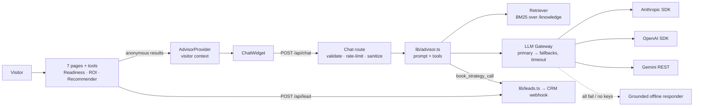

# NSM Technologies — Website

Next.js 16 (App Router, TypeScript) marketing site with three self-service AI assessment tools and a model-agnostic, RAG-grounded AI Advisor chatbot.

## Quick start
```bash
npm install
cp .env.example .env.local   # add at least one LLM key (optional: runs in offline mode without)
npm run dev                  # http://localhost:3000
npm run build && npm start   # production
```

## Architecture


| Path | Responsibility |
|---|---|
| `app/*` | Pages: `/`, `/capabilities`, `/solutions`, `/assess`, `/approach`, `/about`, `/contact` |
| `app/api/chat`, `app/api/lead` | API routes (input validation, IP rate limit, honeypot) |
| `components/` | UI + client tools (`ReadinessQuiz`, `RoiCalculator`, `UseCaseRecommender`, `ChatWidget`, …) |
| `lib/content.ts` | All marketing copy / use cases / engagement models (single source of truth) |
| `lib/assessment.ts`, `lib/roi.ts`, `lib/recommender.ts` | Pure scoring logic, shared by UI **and** the chatbot tools |
| `lib/llm/` | Provider adapters + gateway with failover |
| `lib/knowledge/retriever.ts` + `knowledge/*.md` | RAG grounding (edit the markdown to update what the bot knows) |
| `lib/leads.ts` | Lead validation + CRM webhook |

## Switching LLM providers
Change `DEFAULT_LLM_PROVIDER` (`anthropic` \| `openai` \| `gemini`) and `LLM_FALLBACK_ORDER`. Providers without a key are skipped. On timeout or error the gateway fails over; tool side effects are memoized per request so a failover never books a lead twice.
- Claude adapter uses the official SDK with low effort (chat latency) and server-side refusal fallback (`ANTHROPIC_SERVER_FALLBACK=false` to disable, e.g. for older models).
- Add a provider: implement `LLMProvider` in `lib/llm/`, register it in `gateway.ts`.

## Chatbot tools
- `calculate_roi_estimate(team_size, manual_hours, hourly_rate, efficiency?)` → same model as the on-page calculator.
- `book_strategy_call(name, email, company, summary_of_needs)` → validated, POSTed to `LEAD_WEBHOOK_URL` (HubSpot/Salesforce/n8n/Make/Zapier), returns `BOOKING_URL`.

## Production checklist
- **Rate limiting** is in-memory per instance → back with Redis/Upstash on serverless or multi-instance.
- **RAG**: BM25 is right for ~dozens of docs. For larger corpora (case studies, blogs), implement `Retriever` on pgvector/Pinecone with embeddings.
- **Pricing bands** in `lib/roi.ts` and `knowledge/engagements.md` are placeholders — replace with real numbers.
- **Benchmarks** in `lib/assessment.ts` (`smeBenchmark`) are indicative — replace with your own data as it accumulates.
- Add analytics events (assessment complete, ROI discuss, blueprint sent, lead submitted) and an eval set for advisor answers before scaling traffic.
- Set `NEXT_PUBLIC_SITE_URL`, a real `site.email` in `lib/content.ts`, and a Content-Security-Policy at the edge.
